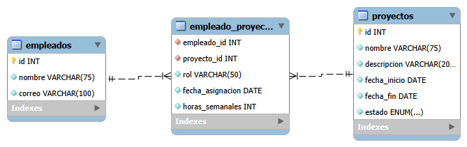

<div align="center">

# 🏢 Gestión de Proyectos Empresariales

**Aplicación Java de consola para organizar proyectos y administrar la participación de los empleados, conectada a MySQL mediante JDBC.**


</div>

---

## 📑 Tabla de contenido

- [Descripción](#-descripción)
- [Funcionalidades](#-funcionalidades)
- [Arquitectura](#-arquitectura)
- [Estructura del proyecto](#-estructura-del-proyecto)
- [Modelo de datos](#-modelo-de-datos)
- [Reglas de negocio](#-reglas-de-negocio)
- [Conceptos aplicados](#-conceptos-aplicados)
- [Instalación](#-instalación)
- [Uso](#-uso)
- [Flujo de trabajo con Git](#-flujo-de-trabajo-con-git)
- [Autor](#-autor)

---

## 📖 Descripción

Una empresanecesita saber **quién participa en cada proyecto**, **qué proyectos tiene cada empleado** y **qué función cumple cada persona** dentro de un proyecto.

Un empleado puede trabajar en varios proyectos y un proyecto puede tener varios empleados. Esta relación **muchos a muchos** se resuelve con una tabla intermedia que guarda información propia de la asignación: **rol**, **fecha de asignación** y **horas semanales**.

---

## ✨ Funcionalidades

| Código | Requisito | Descripción |
|:---:|---|---|
| `RF-01` | 👤 Registrar empleados | Guarda nombre, correo y cargo |
| `RF-02` | 📋 Listar y buscar empleados | Lista todos o busca por ID |
| `RF-03` | ✏️ Actualizar y eliminar empleados | No permite eliminar empleados con asignaciones activas |
| `RF-04` | 📁 Registrar proyectos | Guarda nombre, descripción, fechas y estado |
| `RF-05` | 🔎 Listar y buscar proyectos | Lista todos o busca por ID |
| `RF-06` | 🛠️ Actualizar y eliminar proyectos | Respeta la integridad referencial |
| `RF-07` | 🔗 Asignar empleado a proyecto | Registra rol, fecha y horas semanales |
| `RF-08` | 👥 Integrantes de un proyecto | Muestra empleados, cargos, roles y horas |
| `RF-09` | 🗂️ Proyectos de un empleado | Muestra sus proyectos y el rol en cada uno |
| `RF-10` | 🔄 Modificar una asignación | Cambia rol y horas sin duplicar la asignación |
| `RF-11` | 🚪 Retirar empleado de un proyecto | Elimina solo la asignación indicada |
| `RF-12` | ✅ Validar entradas | Rechaza datos vacíos, IDs inválidos, horas incorrectas y referencias inexistentes |

---

## 🏗️ Arquitectura


| Capa | Responsabilidad |
|---|---|
| 🎨 **Vista** | Muestra los menús y devuelve la opción elegida |
| 🎮 **Controlador** | Coordina el flujo: pide datos, aplica reglas y llama a los DAO |
| 🧩 **Modelo (clases)** | Representa las entidades del negocio |
| 💾 **Modelo (DAO)** | Ejecuta las operaciones SQL y convierte filas en objetos |
| ⚙️ **Configuración** | Lee las credenciales y administra la conexión |
| 🧰 **Utilidades** | Valida entradas y traduce los errores de la base de datos |
| 🚀 **Main** | Crea todas las piezas, las une y arranca el menú principal |

---

## 📂 Estructura del proyecto

```
Gestion_Proyectos_Empresariales
├── 📁 assests/img/
│   └── Diagrama_UML_ER.png
├── 📁 db/
│   ├── DDL.sql                     → Creación de base de datos y tablas
│   └── TRIGGERS.sql                → Reglas de negocio en MySQL
├── 📁 src/main/
│   ├── 📁 java/com/AlanGomez/gestion_proyectos_empresariales/
│   │   ├── 📁 controlador/
│   │   │   ├── EmpleadoControlador.java
│   │   │   ├── ProyectoControlador.java
│   │   │   └── EmpleadoProyectoControlador.java
│   │   ├── 📁 modelo/
│   │   │   ├── 📁 clases/
│   │   │   │   ├── Empleado.java
│   │   │   │   ├── Proyecto.java
│   │   │   │   ├── EmpleadoProyecto.java
│   │   │   │   └── Estado.java              (enum)
│   │   │   ├── 📁 config/
│   │   │   │   ├── ConexionBD.java          (Singleton)
│   │   │   │   └── ConfiguracionBD.java     (record)
│   │   │   └── 📁 dao/
│   │   │       ├── Mapear.java              (interfaz genérica)
│   │   │       ├── OperacionesDAO.java      (clase abstracta)
│   │   │       ├── EmpleadoDAO.java
│   │   │       ├── ProyectosDAO.java
│   │   │       └── EmpleadoProyectoDAO.java
│   │   ├── 📁 utilidades/
│   │   │   ├── EntradaConsola.java
│   │   │   ├── TipoTexto.java               (enum con regex)
│   │   │   └── ManejadorErroresBD.java
│   │   ├── 📁 vista/
│   │   │   ├── VistaPrincipal.java
│   │   │   ├── VistaEmpleado.java
│   │   │   ├── VistaProyecto.java
│   │   │   └── VistaEmpleadoProyecto.java
│   │   └── Main.java
│   └── 📁 resources/
│       ├── db.properties                    (ignorado por Git)
│       └── db.properties.example
├── pom.xml
└── README.md
```

---

## 🗄️ Modelo de datos



> 🔑 La tabla `Empleado_Proyecto` usa una **clave primaria compuesta** (`empleado_id`, `proyecto_id`), lo que impide asignar dos veces a la misma persona en el mismo proyecto.

---

## 🧠 Conceptos aplicados

### 🔌 Interfaz genérica funcional: `Mapear`

Define un contrato para convertir una fila de la base de datos en un objeto. Al ser **genérica**, la reutilizan todos los DAO con tipos distintos.

```java
@FunctionalInterface
public interface Mapear<ObjetoRecibir, ObjetoDevolver> {
    ObjetoDevolver mapear(ObjetoRecibir rs) throws SQLException;
}

public class EmpleadoDAO extends OperacionesDAO implements Mapear<ResultSet, Empleado> { ... }
```

### 🧬 Herencia con clase abstracta: `OperacionesDAO`

Centraliza la obtención de la conexión. Todos los DAO **heredan** este comportamiento sin repetir código.

```java
public abstract class OperacionesDAO {
    protected Connection obtenerConexion() throws SQLException {
        return ConexionBD.obtenerInstancia().obtenerConexion();
    }
}
```

### 🔒 Patrón Singleton: `ConexionBD`

Garantiza **una sola instancia** que administra la conexión, gracias a su constructor privado y a una constante `static final`.

### 🏷️ Enums con comportamiento

- **`Estado`**: los estados válidos del proyecto, con un nombre amigable para mostrar.
- **`TipoTexto`**: cada constante guarda **su propia expresión regular y su mensaje de error**, y se valida sola con `esValido()`. Agregar un tipo nuevo no obliga a modificar `EntradaConsola` (principio Abierto/Cerrado).

```java
SOLO_LETRAS("^[\\p{L} ]+$", "Solo se permiten letras"),
CORREO("^[\\w.+-]+@[\\w-]+(\\.[\\w-]+)+$", "El correo debe tener el formato usuario@dominio.com");
```

### 🛡️ `PreparedStatement` contra SQL injection

Todas las consultas usan parámetros `?`. Los datos del usuario se envían **separados** de la consulta, así que nunca se ejecutan como código SQL.

### ♻️ `try-with-resources`

Las conexiones, los `PreparedStatement` y los `ResultSet` se cierran automáticamente, aunque ocurra un error.

### 🗺️ `Map` con objetos como clave

Las consultas que unen tablas devuelven un `LinkedHashMap` (conserva el orden del `ORDER BY`), con la asignación como clave:

```java
Map<EmpleadoProyecto, Empleado> integrantes   // RF-08
Map<EmpleadoProyecto, Proyecto> proyectos     // RF-09
```

`EmpleadoProyecto` sobrescribe `equals()` y `hashCode()` usando su **llave compuesta**, igual que en la base de datos.

### 🔗 Encadenamiento de constructores

Un constructor reutiliza a otro con `this(...)`. La constante `ID_SIN_ASIGNAR` indica que el objeto todavía no se guarda en la base de datos.

```java
public Empleado(String nombre, String correo, String cargo) {
    this(ID_SIN_ASIGNAR, nombre, correo, cargo);
}
```

### 🧰 Clases de utilidad

`EntradaConsola` y `ManejadorErroresBD` son `final`, con constructor `private` y métodos `static`. Hay **un solo `Scanner`** para todo el programa.


### 🐬 Triggers en MySQL

| Trigger | Momento | Función |
|---|---|---|
| `trg_validar_Fecha_inicio_finalizacion` | `BEFORE INSERT` | Valida las fechas al crear un proyecto |
| `tgr_eliminar_empleado_sin_asignacion` | `BEFORE DELETE` | Impide eliminar empleados con asignaciones |

### 🧱 Principios SOLID

| Principio | Aplicación |
|---|---|
| **S** · Responsabilidad única | Cada clase tiene un solo trabajo: `ConfiguracionBD` lee, `ConexionBD` conecta, cada DAO accede a su tabla |
| **O** · Abierto/Cerrado | Nuevos tipos de texto en `TipoTexto` sin tocar `EntradaConsola` |
| **L** · Sustitución de Liskov | Todos los DAO pueden usarse donde se espera un `OperacionesDAO` |
| **I** · Segregación de interfaces | `Mapear` exige un solo método, pequeño y específico |
| **D** · Inversión de dependencias | Los controladores reciben sus vistas y DAO por constructor desde `Main` |

---

## 🚀 Instalación

### 📋 Requisitos

- ☕ JDK 25 o superior
- 🐬 MySQL 8
- 📦 Maven (incluido en NetBeans)

### 1️⃣ Clonar el repositorio

```bash
git clone <url-del-repositorio>
```

### 2️⃣ Crear la base de datos

Ejecuta en MySQL los scripts de la carpeta `db/` **en este orden**:

```
1. db/DDL.sql
2. db/TRIGGERS.sql
```

### 3️⃣ Configurar las credenciales

Copia el archivo de ejemplo y escribe tus datos:

```bash
cp src/main/resources/db.properties.example src/main/resources/db.properties
```

```properties
db.url=jdbc:mysql://localhost:3306/proyectos_empresariales
db.usuario=tu_usuario
db.contrasenia=tu_contraseña
```

> ⚠️ `db.properties` está en `.gitignore`. **Nunca subas tus credenciales al repositorio.**

### 4️⃣ Ejecutar

Abre el proyecto en NetBeans y ejecuta la clase `Main`, o desde la terminal:

```bash
mvn compile exec:java
```

---

## 🎮 Uso

### Menú principal

```
===== GESTIÓN DE PROYECTOS EMPRESARIALES =====
1. Empleados
2. Proyectos
3. Asignaciones (Empleado - Proyecto)
0. Salir
```

Cada opción abre su propio CRUD. La opción **Actualizar** abre un submenú para elegir qué dato modificar.

### Ejemplo: integrantes de un proyecto

```
Integrantes del proyecto: Sistema de inventario
ID    Empleado                  Cargo                Rol                  Horas  Asignado
---------------------------------------------------------------------------------------------
1     Ana López                 Desarrolladora       Líder de proyecto    20     2026-08-01
3     José Pérez                Analista Senior      Analista             30     2026-08-05
```

### Ejemplo: validaciones en acción

```
Nombre: Ana3
Error: Solo se permiten letras.
Correo: correo-malo
Error: El correo debe tener el formato usuario@dominio.com.
Horas semanales: 50
Error: El número debe estar entre 1 y 40
```

---

## 👨 AUTOR

Programador Full-Stack Jr. Alan Gomez

GitHub: [AlanGomez-Programmer](https://github.com/AlanGomez-Programmer)

LinkedIn: alan-gomez-763163320